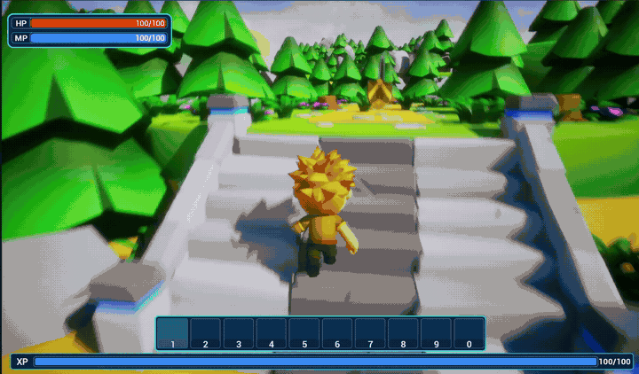
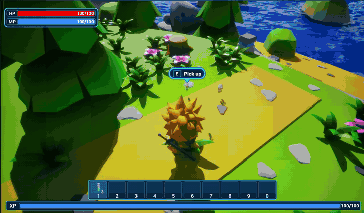
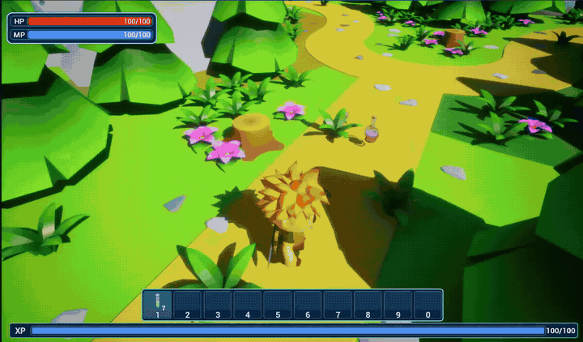
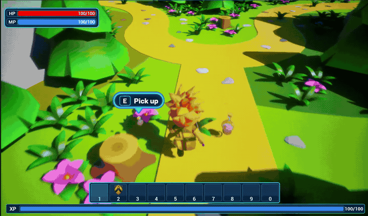

# Ultimate Stats Framework RPG Demo

An evolving RPG demo built with **Unreal Engine 5.7** and [Ultimate Stats Framework](https://www.fab.com/listings/311ce299-b6bf-49f0-a4f3-9b0165b6e674). The project demonstrates how to build connected RPG systems with the framework and serves as a starting point for further experimentation.

## Gameplay Preview

Four short clips from an approximately 81-second gameplay recording show item pickups, the inventory and hotbar, character attributes, and the carry-weight limit.

## Installing the Project

If you want to install this project, follow the [RPG Demo Project installation guide](https://roogame.gitbook.io/roogame/ultimate-stats-framework/installing-rpg-demo-project).

## Building a Complete RPG Game

This project will gradually evolve into a complete RPG game and aims to cover as many common RPG features as possible. For detailed, step-by-step development guides, see [Build a Complete RPG Game](https://roogame.gitbook.io/roogame/ultimate-stats-framework/build-a-complete-rpg-game).

## Current Features

This demo connects the framework's character stats, inventory, equipment, and world interactions into a playable RPG loop:

- **Complete attribute system:** The player has HP and MP attributes alongside stats such as Max HP, Max MP, Attack, Defense, Level, and MP Regeneration. The attribute panel displays the character's current values, while the in-game HUD keeps HP, MP, and EXP visible during play.
- **Inventory system and equipment:** A grid-based backpack and equipment slots let you organize items through drag-and-drop. Items can occupy multiple cells and be rotated to fit. Stackable items support stacking, splitting stacks, and placing items one at a time. The inventory, equipment panel, and hotbar share the same item data, so moving an item between them changes where it is held rather than creating a separate copy.
- **Carry-weight system:** The inventory and HUD display current weight against the carrying limit. Pickups that exceed the limit show a **Too Heavy** prompt; a full inventory has its own **Inventory Full** prompt.
- **Pickups and interaction:** The world includes pickupable equipment and potion items with visual representations, including a sword, shield, Health potion, Mana potion, Regeneration potion, and Poison potion. Looking at an item shows an interaction prompt, and pressing **E** picks it up through the framework's pickup system.
- **A sword with a stat bonus:** Equipping the sword grants **+5 Attack**. Its visual representation is attached to the character using sockets, connecting the equipped item to what you see on the player.
- **Ten-slot hotbar:** Items can be moved into the hotbar and selected with the **1–9** and **0** keys. The UI shows each slot's item and its selected state.
- **Third-person gameplay:** Character movement, animation, and a third-person camera provide a playable setting for these systems.

## Free Third-Party Assets

This project includes free character and environment assets by **Dungeon Mason**, including *RPG Hero Squad PBR Polyart* and *RPG Tiny Fantasy Forest*. If you enjoy these assets or want to use them in your own project, you can obtain them and explore more of the creator's work on the [Dungeon Mason Fab store](https://www.fab.com/sellers/Dungeon%20Mason).

The demo also uses [*Magic Potion Free game-ready 3D asset*](https://www.fab.com/listings/2ccf2dbb-913b-45f4-808a-3336e0ee83c4) by [BreeIri](https://www.fab.com/sellers/BreeIri). Visit the creator's Fab store to explore more of their work.

## Planned Updates

- Item tooltips with more detailed information.
- A status-effect system and UI.
- A Health potion that restores HP directly.
- A regeneration-buff potion that applies a healing-over-time effect.
- A throwable Poison potion that creates a poison cloud on impact.
- A Mana potion that restores MP.
